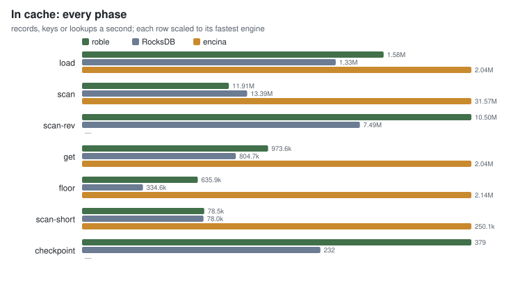
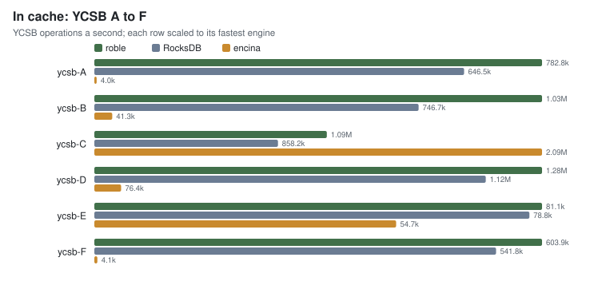
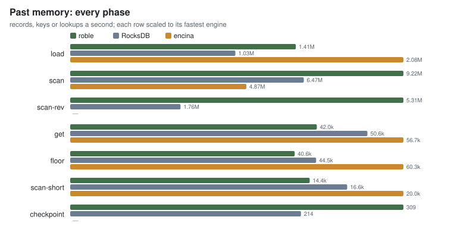
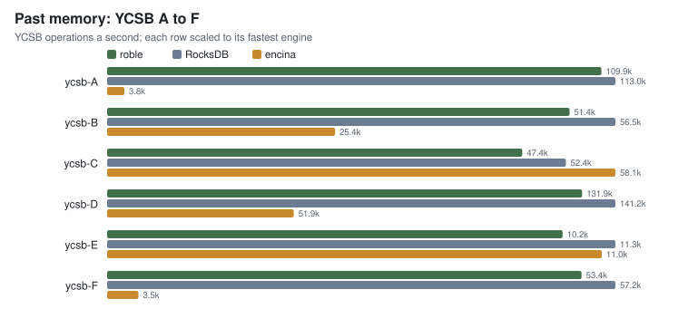
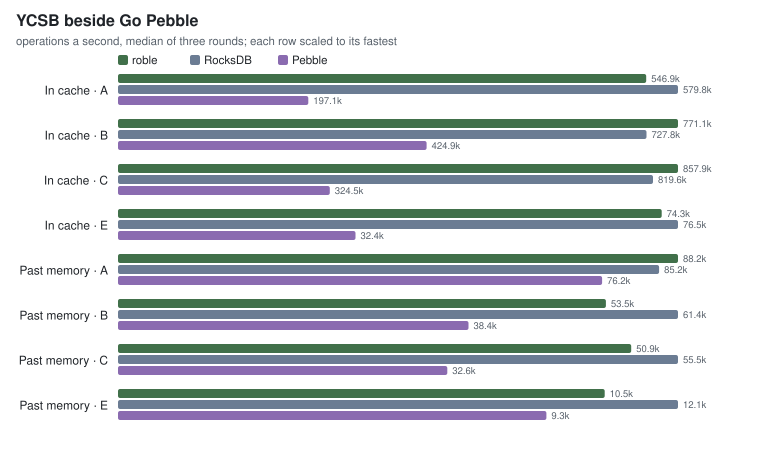
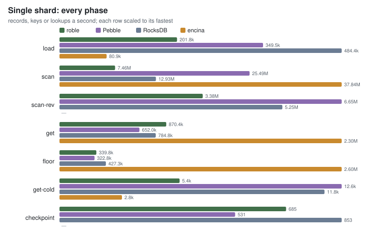

<!-- Generated by render.py from the CSVs beside it: edit those, or the script, and run it again. -->

# Benchmark results

What `roble-bench` measured, kept with the data it was drawn from. How the runs are made and what each phase does is in [the bench README](../README.md). A rate here is a property of one machine on one day: read the engines against each other within a run, not a rate against another run.

## The standard run

`bench/run.sh` on a Linux VM at main `1369bad`, 18 November 2026: every engine held to one CPU and 512 MiB (page cache included), the WAL off as Oxia runs it, over a store that fits the 256 MiB block cache (1,400,000 records) and one that does not fit in memory at all (6,000,000). Each cell is the median of three runs, taken with the VM's file indexer off. encina has no reverse scan and no checkpoint. Data: [`standard.csv`](2026-11-18-standard-1369bad/standard.csv).

In cache: every number

| phase | roble | RocksDB | encina |
|---|---:|---:|---:|
| load | 1.58M | 1.33M | 2.04M |
| scan | 11.91M · p50 0.1 µs | 13.39M · p50 0.1 µs | 31.57M · p50 0 µs |
| scan-rev | 10.50M · p50 0.1 µs | 7.49M · p50 0.1 µs | — |
| get | 973.6k · p50 0.9 µs | 804.7k · p50 1 µs | 2.04M · p50 0.3 µs |
| floor | 635.9k · p50 1.4 µs | 334.6k · p50 2.8 µs | 2.14M · p50 0.3 µs |
| scan-short | 78.5k · p50 3.7 µs | 78.0k · p50 4.4 µs | 250.1k · p50 1 µs |
| checkpoint | 379 · p50 2605.1 µs | 232 · p50 4259.8 µs | — |
| ycsb-A | 782.8k · p50 0.7 µs | 646.5k · p50 0.8 µs | 4.0k · p50 238.6 µs |
| ycsb-B | 1.03M · p50 0.6 µs | 746.7k · p50 0.8 µs | 41.3k · p50 0.7 µs |
| ycsb-C | 1.09M · p50 0.8 µs | 858.2k · p50 1 µs | 2.09M · p50 0.4 µs |
| ycsb-D | 1.28M · p50 0.5 µs | 1.12M · p50 0.5 µs | 76.4k · p50 0.5 µs |
| ycsb-E | 81.1k · p50 3.6 µs | 78.8k · p50 4.8 µs | 54.7k · p50 1.9 µs |
| ycsb-F | 603.9k · p50 1 µs | 541.8k · p50 1.2 µs | 4.1k · p50 234.5 µs |
| peak RSS, MiB | 217 | 223 | 223 |

Past memory: every number

| phase | roble | RocksDB | encina |
|---|---:|---:|---:|
| load | 1.41M | 1.03M | 2.08M |
| scan | 9.22M · p50 0.1 µs | 6.47M · p50 0.1 µs | 4.87M · p50 0 µs |
| scan-rev | 5.31M · p50 0.1 µs | 1.76M · p50 0.1 µs | — |
| get | 42.0k · p50 2.7 µs | 50.6k · p50 2.5 µs | 56.7k · p50 1.1 µs |
| floor | 40.6k · p50 3.3 µs | 44.5k · p50 4.4 µs | 60.3k · p50 1 µs |
| scan-short | 14.4k · p50 17.3 µs | 16.6k · p50 12.9 µs | 20.0k · p50 11 µs |
| checkpoint | 309 · p50 3129.3 µs | 214 · p50 4489.2 µs | — |
| ycsb-A | 109.9k · p50 1.5 µs | 113.0k · p50 1.4 µs | 3.8k · p50 233.5 µs |
| ycsb-B | 51.4k · p50 2.5 µs | 56.5k · p50 2.7 µs | 25.4k · p50 1.4 µs |
| ycsb-C | 47.4k · p50 2.4 µs | 52.4k · p50 2.9 µs | 58.1k · p50 1.3 µs |
| ycsb-D | 131.9k · p50 1 µs | 141.2k · p50 1.2 µs | 51.9k · p50 0.9 µs |
| ycsb-E | 10.2k · p50 69.6 µs | 11.3k · p50 68.6 µs | 11.0k · p50 82.4 µs |
| ycsb-F | 53.4k · p50 2.5 µs | 57.2k · p50 2.6 µs | 3.5k · p50 247.8 µs |
| peak RSS, MiB | 298 | 298 | 295 |

## Go Pebble beside them

YCSB A, B, C and E on roble, RocksDB and Go Pebble v2.1.7 in one session on the same VM, 16 November 2026, roble at `71cd740`, each under the same one CPU and 512 MiB, Pebble with `GOMAXPROCS=1` and the settings RocksDB gets here. Each bar is the median of three rounds. The Pebble driver that took these is not in this repository. Data: [`pebble-ycsb.csv`](2026-11-16-pebble-71cd740/pebble-ycsb.csv).

Every number: median (slowest–fastest round)

| mix | roble | RocksDB | Pebble |
|---|---:|---:|---:|
| In cache · A | 546.9k (343.0k–549.5k) | 579.8k (565.7k–651.4k) | 197.1k (92.0k–237.6k) |
| In cache · B | 771.1k (360.7k–965.1k) | 727.8k (497.4k–911.2k) | 424.9k (419.9k–508.6k) |
| In cache · C | 857.9k (791.7k–923.2k) | 819.6k (764.8k–876.5k) | 324.5k (319.1k–365.9k) |
| In cache · E | 74.3k (64.0k–74.8k) | 76.5k (75.5k–76.7k) | 32.4k (30.0k–36.9k) |
| Past memory · A | 88.2k (74.2k–116.7k) | 85.2k (82.1k–123.3k) | 76.2k (47.0k–77.4k) |
| Past memory · B | 53.5k (38.5k–55.9k) | 61.4k (59.6k–65.0k) | 38.4k (29.4k–39.6k) |
| Past memory · C | 50.9k (43.1k–51.0k) | 55.5k (47.2k–55.9k) | 32.6k (24.1k–33.3k) |
| Past memory · E | 10.5k (8.9k–10.6k) | 12.1k (11.5k–12.6k) | 9.3k (8.2k–9.8k) |

## An earlier single-shard run

13 November 2026, before the standard above existed: one shard, a 42 MiB store, all four engines on the same Linux machine in one run. Kept for what it measured that the standard does not: the WAL on and off, one record a commit, the cache in and out, and where a scan's time went. Its numbers are not comparable with the sections above.

Phase rates (<code>phases.csv</code>)

| phase | engine | rate | p50_us | cpu_s |
|---|---:|---:|---:|---:|
| load | roble | 201800 | 155 | 0.45 |
| load | Pebble | 349522 | 99 | 0.59 |
| load | RocksDB | 484447 | 167 | 0.33 |
| load | encina | 80938 | 1386 | 0.66 |
| settle | roble | 0 | 1925 | 0.00 |
| settle | Pebble | 2 | 613872 | 0.20 |
| settle | RocksDB | 2 | 631545 | 0.13 |
| settle | encina | 0 | 0 | 0.00 |
| scan | roble | 7457635 | 0 | 0.04 |
| scan | Pebble | 25491614 | 0 | 0.01 |
| scan | RocksDB | 12934576 | 0 | 0.02 |
| scan | encina | 37835836 | 0 | 0.01 |
| scan-rev | roble | 3376329 | 0 | 0.09 |
| scan-rev | Pebble | 6650167 | 0 | 0.05 |
| scan-rev | RocksDB | 5252588 | 0 | 0.06 |
| get | roble | 870412 | 0 | 0.06 |
| get | Pebble | 651980 | 1 | 0.08 |
| get | RocksDB | 784768 | 1 | 0.06 |
| get | encina | 2300599 | 0 | 0.02 |
| floor | roble | 339826 | 2 | 0.15 |
| floor | Pebble | 322795 | 2 | 0.16 |
| floor | RocksDB | 427319 | 2 | 0.12 |
| floor | encina | 2598317 | 0 | 0.02 |
| get-cold | roble | 5361 | 151 | 0.00 |
| get-cold | Pebble | 12591 | 73 | 0.00 |
| get-cold | RocksDB | 11825 | 28 | 0.00 |
| get-cold | encina | 2788 | 353 | 0.00 |
| checkpoint | roble | 685 | 1423 | 0.00 |
| checkpoint | Pebble | 531 | 1879 | 0.00 |
| checkpoint | RocksDB | 853 | 1126 | 0.00 |

Writes: journal on and off, batched and one a commit (<code>writes.csv</code>)

| scenario | engine | rate | cpu_s | size_mib |
|---|---:|---:|---:|---:|
| journal on | roble | 152026 | 0.51 | 42.4 |
| journal on | Pebble | 149986 | 0.89 | 64.3 |
| journal on | RocksDB | 181938 | 0.50 | 79.2 |
| journal on | encina | 80676 | 0.64 | 44.0 |
| journal off | roble | 227095 | 0.40 | 41.6 |
| journal off | Pebble | 417755 | 0.53 | 44.3 |
| journal off | RocksDB | 477003 | 0.35 | 44.9 |
| journal off | encina | 81349 | 0.73 | 44.0 |
| batched | roble | 215884 | 0.38 | 41.6 |
| batched | Pebble | 343522 | 0.52 | 60.6 |
| batched | RocksDB | 503308 | 0.32 | 44.9 |
| batched | encina | 81025 | 0.65 | 44.0 |
| one per commit | roble | 201090 | 0.47 | 41.3 |
| one per commit | Pebble | 396225 | 0.64 | 40.6 |
| one per commit | RocksDB | 436622 | 0.49 | 55.6 |
| one per commit | encina | 4147 | 20.24 | 152.0 |

Reads with the cache holding the store, and an eighth of it (<code>cache.csv</code>)

| cache | phase | engine | rate | p50_us |
|---|---:|---:|---:|---:|
| in | get | roble | 689094 | 1 |
| in | get | Pebble | 581234 | 1 |
| in | get | RocksDB | 785716 | 1 |
| in | get | encina | 2285162 | 0 |
| in | floor | roble | 227762 | 3 |
| in | floor | Pebble | 319568 | 2 |
| in | floor | RocksDB | 417976 | 2 |
| in | floor | encina | 2607336 | 0 |
| in | scan | roble | 7696359 | 0 |
| in | scan | Pebble | 24288806 | 0 |
| in | scan | RocksDB | 12949421 | 0 |
| in | scan | encina | 35260579 | 0 |
| out | get | roble | 264391 | 3 |
| out | get | Pebble | 131930 | 7 |
| out | get | RocksDB | 303696 | 3 |
| out | get | encina | 8303 | 123 |
| out | floor | roble | 171010 | 5 |
| out | floor | Pebble | 66518 | 14 |
| out | floor | RocksDB | 230634 | 4 |
| out | floor | encina | 8517 | 121 |
| out | scan | roble | 7194822 | 0 |
| out | scan | Pebble | 16149385 | 0 |
| out | scan | RocksDB | 9233638 | 0 |
| out | scan | encina | 285464 | 0 |

Tables per level after settling (<code>layout.csv</code>)

| engine | level | tables | overlapping | searched_for_a_get |
|---|---:|---:|---:|---:|
| roble | L0 | 1 | one table only | 1 |
| roble | L1 | 13 | none | 1 |
| Pebble | L6 | 11 | none | 1 |
| RocksDB | L6 | 21 | none | 1 |

roble's scan rate at each step of that week's work (<code>scanwork.csv</code>)

| stage | direction | rate | cpu_s |
|---|---:|---:|---:|
| before | forward | 1936410 | 0.153 |
| no per-source copy | forward | 2934673 | 0.100 |
| no value allocation | forward | 3350414 | 0.090 |
| one source per level | forward | 4360066 | 0.070 |
| before | reverse | 1609103 | 0.185 |
| no value allocation | reverse | 2271889 | 0.130 |
| one source per level | reverse | 2694331 | 0.110 |

A scan step's fixed and per-byte cost (<code>steps.csv</code>)

| engine | stage | fixed_ns | per_byte_ns |
|---|---:|---:|---:|
| roble | before | 131 | 1.18 |
| roble | after | 81 | 1.18 |
| Pebble | measured | 47 | 0.38 |

